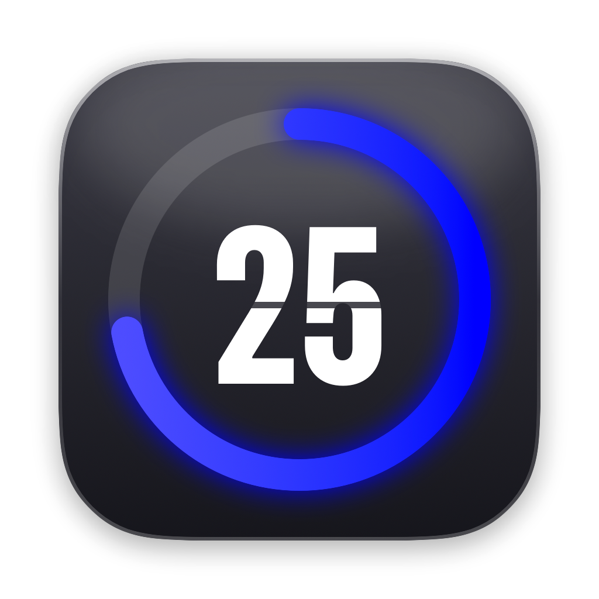
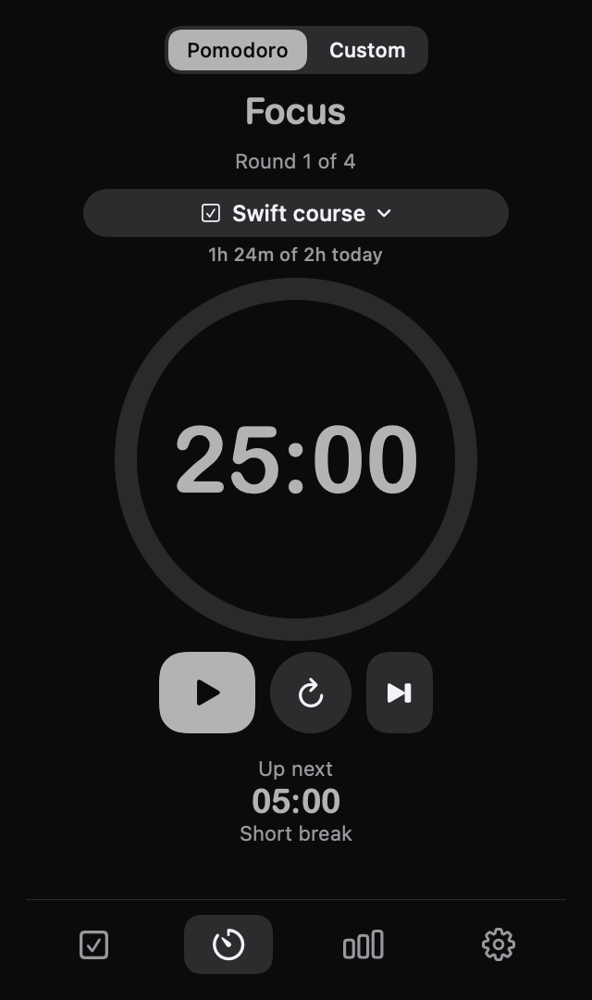
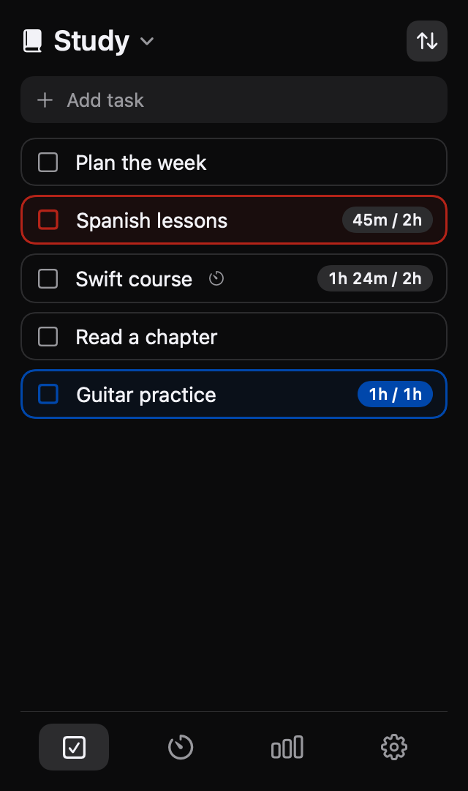
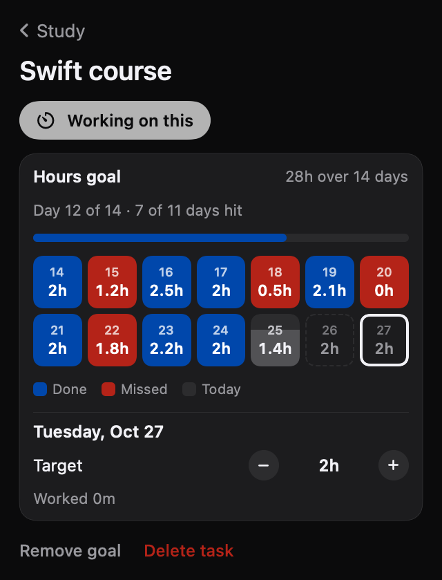
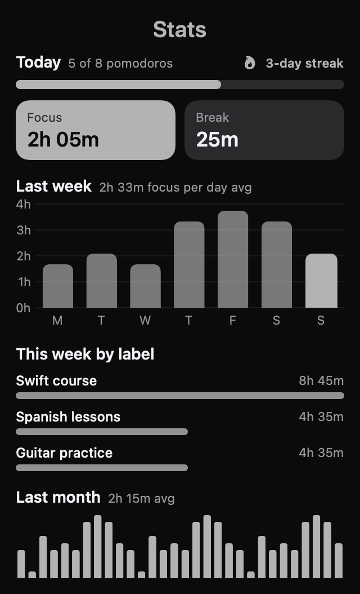
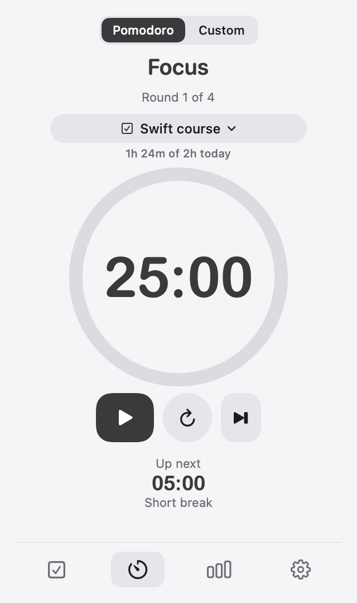
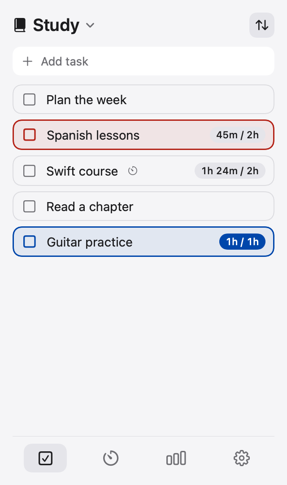
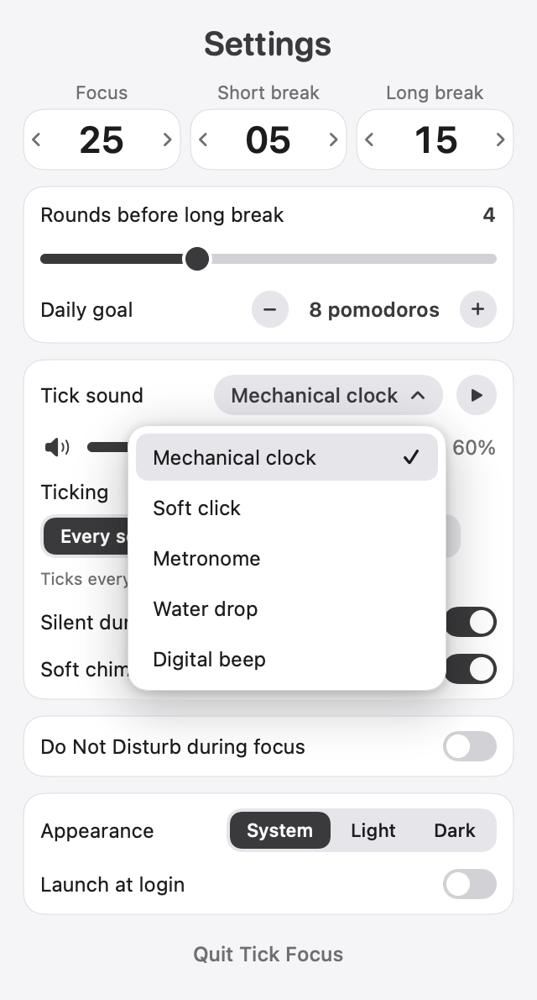
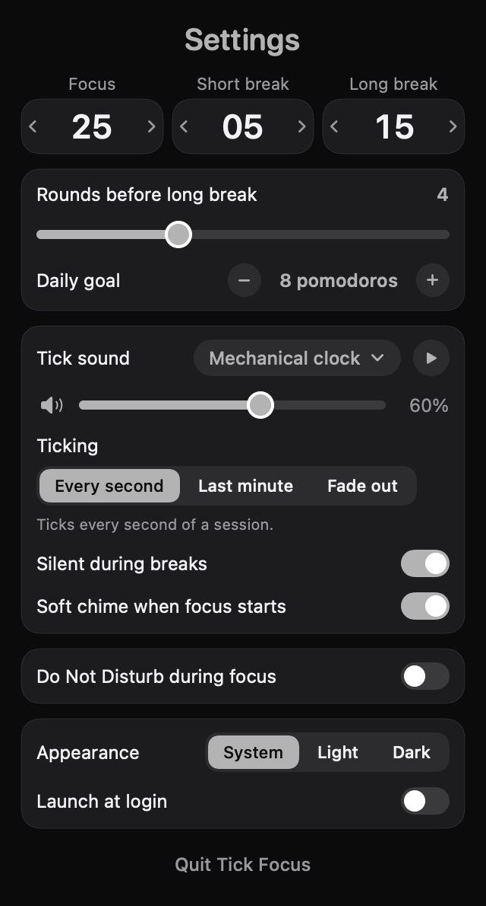

<p align="center">
  
</p>

<h1 align="center">Tick Focus</h1>

<p align="center">
  A menu bar Pomodoro timer for macOS that ticks every second, tracks the hours you put into each task,<br>
  and shows at a glance whether you're on track: <b>blue</b> when today's hours are done, <b>red</b> when you fell behind.
</p>

<p align="center">
  
</p>

<p align="center">
  
  
  
  
</p>

---

## Features

### ⏱ Focus timer that lives in your menu bar
- **Always visible countdown**: a small pill in the menu bar shows the time left (`21:14`) and whether you're focusing, on a break or paused.
- **Pomodoro mode**: focus → short break, with a long break after every few rounds. All durations are adjustable (focus 1–120 min, short break 1–60, long break 1–90, 2–8 rounds per cycle).
- **Custom timer**: any one-off countdown from 1 to 180 minutes.
- **Start, pause, reset and skip** from the panel, or **right-click the pill** for a quick menu without opening anything.
- **Clean, readable clock**: big rounded digits inside a progress ring that fills as the session runs.

### 🔊 The tick, done properly
- **Ticks every second** until time's up, the way a real kitchen timer keeps you honest.
- **Five tick sounds**: mechanical clock (alternating tick/tock), soft click, metronome (accent every 4th beat), water drop and digital beep, each with an instant preview.
- **Three ticking patterns**: every second, only the last minute, or fade out over the first five minutes. The final minute always ticks so you hear time running out.
- **Soft chime** when a focus session starts and a **bell** when time is up.
- **Volume slider and mute**, plus an option to keep breaks silent.
- **Every sound is synthesized in code**: no audio files, nothing to license or download.

### ✅ Tasks with hours goals
- **Lists and tasks**: create lists (like "Study" or "Work"), add tasks, check them off, and group or sort them (custom order, name, or progress).
- **Hours goals**: give a task a total, e.g. *28 hours over 14 days*. The hours are spread evenly across the days, and you can change any single day (more on Saturday, a rest day on Sunday).
- **Hours count themselves**: pick the task under **Working on** in the Timer, and every finished focus session adds its minutes to that task's day.
- **See your progress at a glance**:
  - 🟦 **Blue (Cobalt)**: that day's hours are done.
  - 🟥 **Red (Brick)**: a past day ended short.
  - ⬜ **Grey**: today, still in progress.
  - Each task in the list gets a matching outline: **blue** when today's hours are done, **red** when the last finished day fell short.
- **Day-by-day grid** for every goal, with a summary like *"Day 12 of 14 · 9 of 11 days hit"*.

### 📊 Stats
- **Daily goal** for number of Pomodoros, with a progress bar and a **streak counter** for consecutive days you hit it.
- **Today's focus and break time**, a **last 7 days** chart, and a **last 30 days** overview.
- **Time by task**: see where your hours actually went this week.

### 🛡 Honest time and a well-behaved Mac
- **Only counts real time**: the timer **pauses itself** when your Mac sleeps, the screen turns off, the screen locks or you switch users. You resume it yourself, so no hours are logged while you're away.
- **Accurate to the clock**: the countdown reads the real time, so it never drifts, even with the panel closed.
- **Lets your Mac sleep**: audio only runs while sounds are actually playing.
- **Sessions that cross midnight** are split between the two days.
- **Optional Do Not Disturb** during focus sessions (see [setup](#do-not-disturb-setup)), turned off again when you pause, take a break or quit.

### 🎨 Looks at home on macOS
- **Light, dark or follow the system**, in a calm grey design.
- **Smooth floating menus** with soft shadows.
- **Launch at login**, and no Dock icon: the app stays quietly in the menu bar.
- **Liquid Glass style app icon**.

<p align="center">
  
  
  
  
</p>

---

## Install

Tick Focus is built from source. You need **macOS 14 or later** and the **Swift command-line tools** (the full Xcode app is not required).

```bash
git clone https://github.com/manpreetsinghpannu/tick-focus.git
cd tick-focus
./build.sh --install
open "/Applications/Tick Focus.app"
```

`./build.sh` on its own builds `build/Tick Focus.app` without installing. Installing to `/Applications` is needed for **Launch at login**.

The app is signed only for your own Mac. If macOS warns about it the first time, open **System Settings → Privacy & Security** and click **Open Anyway**.

## Using it

1. **Click the pill** in the menu bar to open the panel. The four icons at the bottom switch between **Tasks**, **Timer**, **Stats** and **Settings**.
2. In **Tasks**, add a task, tap it, and set an **hours goal** if you want daily tracking.
3. In **Timer**, choose the task under **Working on** and press play.
4. **Right-click the pill** any time for Start/Pause, Skip, Reset and Quit.

### Do Not Disturb setup

macOS doesn't let apps switch Focus modes directly, so Tick Focus uses two Shortcuts you create once in the **Shortcuts** app:

| Shortcut name | Action |
|---|---|
| `Tick Focus On` | Set Focus → Do Not Disturb → **On** |
| `Tick Focus Off` | Set Focus → Do Not Disturb → **Off** |

Then turn on **Settings → Do Not Disturb during focus**. The app confirms once it finds both shortcuts.

## Your data

Everything stays on your Mac. The app makes **no network connections**.

| What | Where |
|---|---|
| Tasks, lists and hours | `~/Library/Application Support/Tick/tasks.json` |
| Stats history | `~/Library/Application Support/Tick/stats.json` |
| Settings | macOS preferences (`com.manpreet.tick`) |

If a data file ever can't be read, it's kept to one side as `*.unreadable-<time>.json` instead of being overwritten.

## Project layout

| File | What it does |
|---|---|
| `TickApp.swift` | App entry, menu bar pill, panel, right-click menu, appearance |
| `TimerEngine.swift` | Countdown, phases and rounds, auto-pause, logging time to stats and tasks |
| `TaskStore.swift` | Lists, tasks, hours goals and day status |
| `StatsStore.swift` | Per-day totals, streaks, time by task |
| `Synth.swift` / `SoundPlayer.swift` | Sound synthesis and playback |
| `FocusMode.swift` | Do Not Disturb via Shortcuts |
| `PanelView.swift`, `TasksTab.swift`, `StatsTab.swift`, `SettingsTab.swift` | The four panel tabs |
| `Components.swift`, `Theme.swift` | Shared controls, colors and clock fonts |
| `AppIcon.swift` | The app icon artwork (`./make-icon.sh` rebuilds `Assets/AppIcon.icns`) |
| `Snapshot.swift` | `Tick --snapshot <dir>` renders every screen to PNGs, with sample data |

## License

MIT. See [LICENSE](LICENSE).
